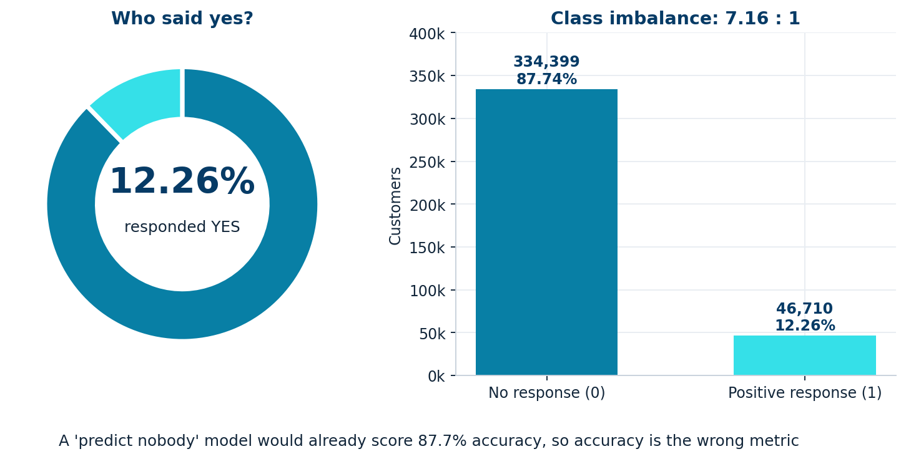

**An end-to-end machine learning project that finds the customers most likely to say *yes* to a vehicle-insurance offer, so marketing teams can spend less and convert more.**

[Business Problem](#-business-problem) · [Key Findings](#-key-findings) · [Data](#-dataset) · [Approach](#-approach) · [Results](#-results) · [Insights](#-business-insights) · [Run It](#-run-it-yourself) · [Limitations](#-limitations-and-next-steps)

</div>

---

## 🎯 Business Problem

Insurance campaigns are expensive and most customers say no. In this dataset **only 12.3% of customers respond positively**, so contacting everyone wastes the budget on the other 87.7%.

The goal is to build a classifier that scores every customer on their likelihood to respond, so a campaign can **focus on the people worth calling**.

| | |
|---|---|
| **Task** | Binary classification (`Response`: 1 = interested, 0 = not interested) |
| **Data** | 381,109 customers, 12 raw features, zero missing values, zero duplicates |
| **Hard part** | Severe class imbalance (7.16 : 1), so accuracy is a misleading metric |
| **Optimised for** | Recall of responders, ROC-AUC, PR-AUC (not accuracy) |

<div align="center">

<br><sub>Companion analytics dashboard</sub>
</div>

---

## 🏆 Key Findings

<table>
<tr>
<td align="center" width="25%"><h2>0.853</h2><b>ROC-AUC</b><br><sub>Tuned LightGBM, held-out test set</sub></td>
<td align="center" width="25%"><h2>87%</h2><b>Responders captured</b><br><sub>recall at the default 0.5 threshold</sub></td>
<td align="center" width="25%"><h2>2.4×</h2><b>Campaign lift</b><br><sub>30% precision vs a 12.3% base rate</sub></td>
<td align="center" width="25%"><h2>0.001</h2><b>Train/test AUC gap</b><br><sub>no sign of overfitting</sub></td>
</tr>
</table>

- **Tuned LightGBM is the best all-round model.** It has the highest ROC-AUC (0.853), PR-AUC (0.358) and F1 (0.446) of the four models, with the smallest generalisation gap.
- **Two features carry about 60% of the signal**: whether the vehicle was previously damaged and whether the customer is already insured.
- **Hyperparameter tuning mattered most for the tree models**: Decision Tree went from 0.801 to 0.844 ROC-AUC and Random Forest from 0.819 to 0.849.
- **Even simple logistic regression is strong here** (0.844 AUC and the highest recall at 91%), which tells us the signal is largely clean and low-dimensional.

---

## 📦 Dataset

381,109 customer records from a vehicle-insurance cross-sell campaign. The dataset file is not included in this repo, so place your copy at `data/data.csv`.

| Feature | Type | Description |
|:---|:---|:---|
| `id` | ID | Unique customer identifier (dropped) |
| `Gender` | Categorical | Male / Female |
| `Age` | Numeric | Age in years (20 to 85) |
| `Driving_License` | Binary | 1 = holds a licence (99.8% do) |
| `Region_Code` | Categorical code | 53 geographic regions |
| `Previously_Insured` | Binary | 1 = customer already has vehicle insurance |
| `Vehicle_Age` | Categorical | `< 1 Year`, `1-2 Year`, `> 2 Years` |
| `Vehicle_Damage` | Binary | Vehicle damaged in the past (Yes/No) |
| `Annual_Premium` | Numeric | Annual premium quoted (₹2,630 to ₹540,165, right-skewed) |
| `Policy_Sales_Channel` | Categorical code | 155 outreach channels |
| `Vintage` | Numeric | Days the customer has been with the company |
| **`Response`** | **Target** | **1 = positive response, 0 = no response** |

### The class imbalance problem

<div align="center">

</div>

A model that predicts "no" for everyone is 87.7% accurate and completely useless. This is why the project is judged on **recall, PR-AUC and ROC-AUC** and not on accuracy.

---

## 🔍 Exploratory Data Analysis

### What separates responders from non-responders?

<div align="center">

</div>

The dashed red line marks the 12.26% overall response rate.

| Signal | Finding |
|:---|:---|
| 🚗 **Vehicle damage** | Customers with a past damage claim respond at **23.8%** versus **0.5%** for those without. This is the strongest single separator. |
| 🛡️ **Previously insured** | Licensed customers who are *not* insured respond at **22.6%**, while already-insured customers respond at **0.1%**. They already have a policy. |
| 📅 **Vehicle age** | Response climbs from **4.4%** (under 1 year) to **17.4%** (1 to 2 years) to **29.4%** (over 2 years). |
| 👤 **Age** | Peaks at **21.2% for ages 40 to 49** and is only **4.1% for 20 to 29** and **6.3% for 80 and above**. |
| 💰 **Annual premium** | Response trends upward with premium, from a low of 9.7% (second decile) to 15.2% in the top decile. |
| ⚧ **Gender** | A modest gap: 13.8% for men versus 10.4% for women. |

### Correlation analysis

<div align="center">

</div>

`Previously_Insured` (-0.34) and `Age` (+0.11) are the only features with a meaningful linear relationship to `Response`. Note that linear correlation understates non-linear effects, which is why the tree models later show `Vehicle_Damage` as the top feature.

---

## 🛠️ Approach

```mermaid
flowchart LR
    A[Raw data<br/>381,109 rows] --> B[Quality checks<br/>0 nulls, 0 duplicates]
    B --> C[Feature selection<br/>drop id, Vintage,<br/>License, Premium]
    C --> D[Stratified split<br/>80 / 20]
    D --> E[Feature engineering<br/>Age_Group bins]
    E --> F[Encoding<br/>one-hot + label]
    F --> G[StandardScaler<br/>fit on train only]
    G --> H[SMOTE<br/>train set only]
    H --> I[4 models<br/>baseline]
    I --> J[RandomizedSearchCV<br/>3-fold stratified]
    J --> K[Evaluate on<br/>untouched test set]
    style A fill:#063B66,color:#fff,stroke:#35E0E8
    style H fill:#087FA5,color:#fff,stroke:#35E0E8
    style K fill:#35E0E8,color:#063B66,stroke:#063B66
```



| Stage | What was done |
|:---|:---|
| **Data quality** | Confirmed no missing values and no duplicate rows. |
| **Feature selection** | Dropped `id` (identifier), and `Vintage`, `Driving_License`, `Annual_Premium` (negligible linear correlation with the target). See [limitations](#-limitations-and-next-steps). |
| **Split** | 80/20 stratified split (`random_state=42`): 304,887 train and 76,222 test rows, with the class ratio preserved. |
| **Feature engineering** | `Age` binned into 6 groups: Young, Early_Adult, Adult, Middle_Aged, Senior, Older. |
| **Encoding** | One-hot for `Vehicle_Age` and `Age_Group`, binary label encoding for `Gender` and `Vehicle_Damage`, with train/test columns aligned. |
| **Scaling** | `StandardScaler` fitted on train only, then applied to test. |
| **Imbalance** | SMOTE on the training set only, taking it from 267,519 / 37,368 to a balanced 267,519 / 267,519. The test set stays untouched. |
| **Models** | Logistic Regression (baseline), Decision Tree, Random Forest, LightGBM. |
| **Tuning** | `RandomizedSearchCV`, 3-fold `StratifiedKFold`, scored on ROC-AUC. |

---

## 📈 Results

All numbers below are on the **held-out test set** (76,222 customers, 9,342 true responders).

### Tuned model scoreboard

| Model | ROC-AUC | PR-AUC | Precision (1) | Recall (1) | F1 (1) | Accuracy |
|:---|:---:|:---:|:---:|:---:|:---:|:---:|
| Logistic Regression | 0.8438 | 0.3331 | 0.28 | **0.91** | 0.43 | 0.71 |
| Decision Tree | 0.8438 | 0.3402 | 0.29 | 0.87 | 0.43 | 0.72 |
| Random Forest | 0.8491 | 0.3548 | 0.30 | 0.83 | 0.44 | 0.74 |
| **LightGBM** 🏅 | **0.8530** | **0.3583** | **0.30** | 0.87 | **0.45** | 0.73 |

<div align="center">

</div>

### ROC curves

<div align="center">

</div>

### Confusion matrices

<div align="center">

</div>

Logistic Regression catches the most responders (91%) but also flags the most false positives. LightGBM gives the best balance. All models choose recall over precision, which suits a campaign where missing a buyer costs more than one extra call.

### Impact of hyperparameter tuning

<div align="center">

</div>

| Model | Baseline AUC | Tuned AUC | Change | Best parameters |
|:---|:---:|:---:|:---:|:---|
| Logistic Regression | 0.844 | 0.844 | ±0.000 | `C=0.616`, `solver=saga`, `penalty=l2` |
| Decision Tree | 0.801 | 0.844 | **+0.043** | `max_depth=15`, `min_samples_split=50`, `min_samples_leaf=10`, `gini` |
| Random Forest | 0.819 | 0.849 | **+0.030** | `n_estimators=50`, `max_depth=20`, `min_samples_split=5`, `min_samples_leaf=2`, `max_features=log2` |
| LightGBM | 0.850 | 0.853 | +0.003 | `num_leaves=63`, `n_estimators=50`, `learning_rate=0.05`, `subsample=0.8`, `colsample_bytree=0.6` |

### Overfitting check

<div align="center">

</div>

LightGBM and Logistic Regression generalise almost perfectly. Random Forest shows the largest train/test gap (0.031), which is still modest.

---

## 💼 Business Insights

### Campaign efficiency

<div align="center">

</div>

Using the tuned LightGBM at the default 0.5 threshold on the test set, a campaign would contact **35.7%** of customers and reach **87.2%** of everyone who would have said yes. That is a **2.4× lift** over random targeting, and the remaining 64% of the list could be skipped.

### What drives a "yes"?

<div align="center">

</div>

**Recommended targeting profile**

1. **Uninsured customers with a past vehicle-damage claim.** They have a clear need and no existing policy, which is the highest-converting segment by a wide margin.
2. **Owners of older vehicles (over 2 years).** They respond at roughly 7× the rate of owners of new vehicles.
3. **Customers aged about 30 to 59.** Younger customers (under 30) respond far less and are lower priority.
4. **Skip customers who already hold insurance.** Their response rate is about 0.1%, so budget spent here is almost entirely wasted.
5. **Investigate sales channels and regions.** `Policy_Sales_Channel` and `Region_Code` are the 4th and 5th most important features, and response varies sharply across codes, so channel mix is a lever worth testing.

---

## 🚀 Run It Yourself

### 1. Clone and install

```bash
git clone https://github.com/abhisek100samal-x/Insurance-Customer-Response-Prediction.git
cd Insurance-Customer-Response-Prediction
pip install pandas numpy scipy matplotlib seaborn plotly scikit-learn imbalanced-learn lightgbm catboost joblib jupyter
```

### 2. Add the data

Place your CSV at `data/data.csv`, then update the load line in the notebook, which is currently a local Windows path:

```python
df = pd.read_csv("data/data.csv")
```

### 3. Run the notebook

```bash
jupyter notebook Insurance_Customer_Response_Prediction__Abhisek_Samal_.ipynb
```

### 4. Score a new customer

The notebook includes a `predict_customer_response()` helper that applies the full preprocessing chain (feature engineering, encoding, column alignment, scaling) before predicting:

```python
customer = {
    "Gender": "Male", "Age": 43, "Region_Code": 28.0,
    "Previously_Insured": 0, "Vehicle_Age": "> 2 Years",
    "Vehicle_Damage": "Yes", "Policy_Sales_Channel": 26.0,
}
# Output: Positive Response Probability: 87.03% -> Will Respond (1)
```

---

## 📁 Repository Structure

```
.
├── Insurance_Customer_Response_Prediction__Abhisek_Samal_.ipynb   # Full analysis and modelling
├── assets/                                                        # README visuals
├── data/                                                          # Place data.csv here (not tracked)
└── README.md
```

---

## ⚠️ Limitations and Next Steps

Being upfront about what this project does and does not prove:

- **Feature selection was based on linear correlation only.** `Annual_Premium` was dropped, yet the EDA shows response rising from 9.7% to 15.2% across premium deciles. A non-linear signal may have been discarded, and the claim that dropping the features improved performance should be backed by an ablation (train with and without them).
- **Cross-validation scores are optimistic.** SMOTE was applied before `RandomizedSearchCV`, so synthetic samples leak across folds (CV AUCs of 0.84 to 0.91 versus test AUCs of 0.84 to 0.85). The **test-set numbers above are the trustworthy ones**. The fix is to place SMOTE inside an `imblearn.pipeline.Pipeline` so it is applied per fold.
- **Probabilities are not calibrated.** Models were trained on SMOTE-balanced data, so predicted probabilities (such as the 87% in the demo) overstate true likelihood. Use them to *rank* customers, or add calibration (isotonic or Platt) before quoting them.
- **The 0.5 threshold is not optimised.** Precision is about 30% at the default cut-off. A threshold chosen from the cost of a contact versus the value of a conversion would make the business case far sharper.
- **The pre-tuning overfitting cell is not valid.** It scores models trained on scaled data using unscaled inputs, producing meaningless AUCs (0.20 to 0.71). Use the tuned-model check shown above.
- **The demo and feature importance use Random Forest**, while LightGBM scored best. Re-running both with the winning model would make the story consistent.

**Roadmap**

- [ ] Per-fold SMOTE with an `imblearn` Pipeline
- [ ] Threshold optimisation using campaign cost and conversion value
- [ ] Probability calibration and a lift/gain chart on the full ranking
- [ ] SHAP explanations for LightGBM
- [ ] Wider search (Optuna) and CatBoost comparison
- [ ] Package the model with `joblib` behind a small FastAPI or Streamlit scoring app

---

## 👤 Author

**Abhisek Samal**
Capstone project: Insurance Customer Response Prediction

If you found this useful, a ⭐ on the repo is appreciated.

<div align="center"><sub>Built with Python, scikit-learn, imbalanced-learn, LightGBM, Plotly and Matplotlib</sub></div>
